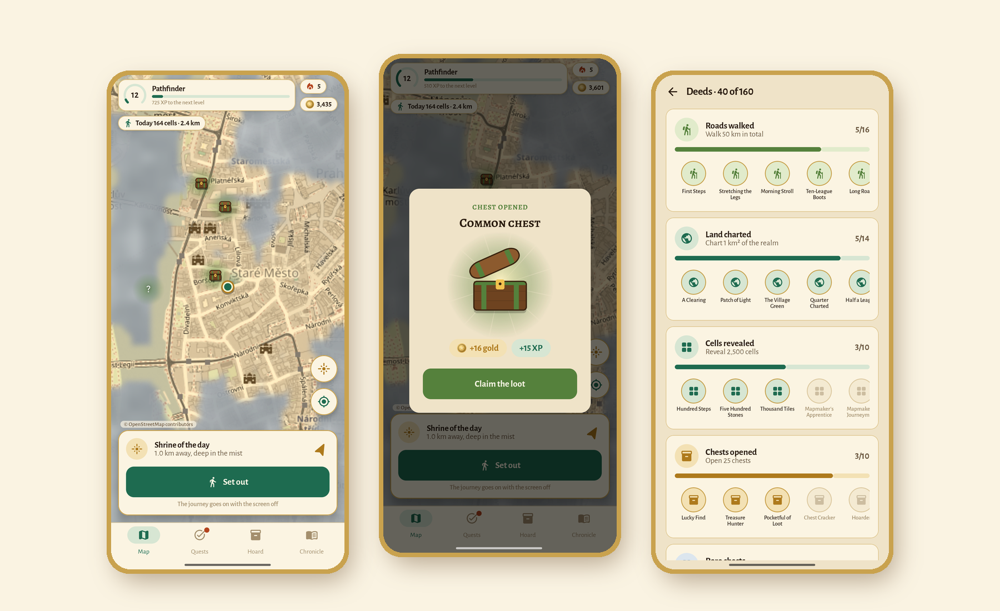
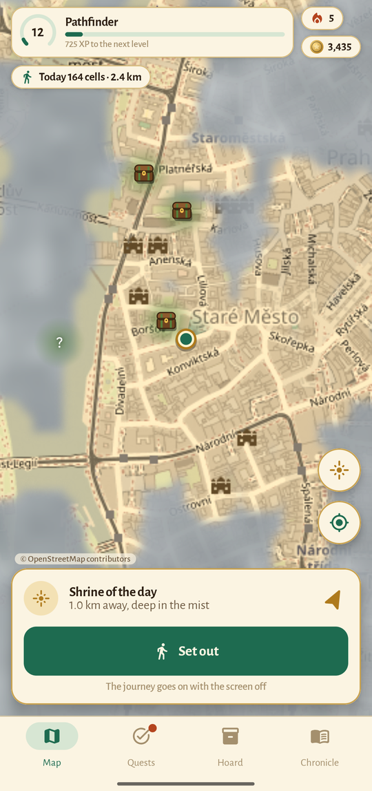
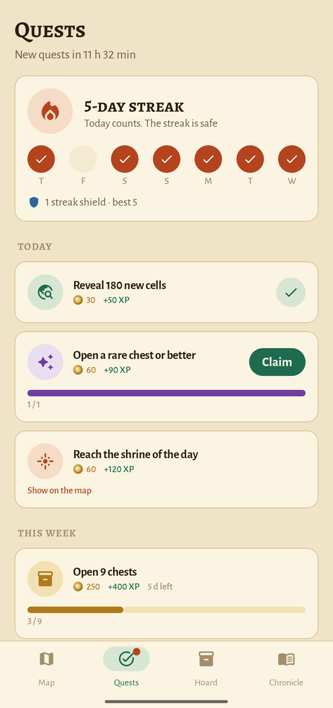
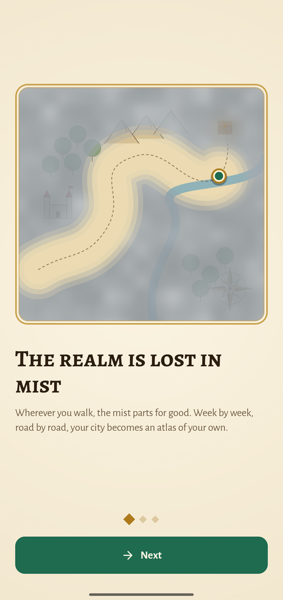
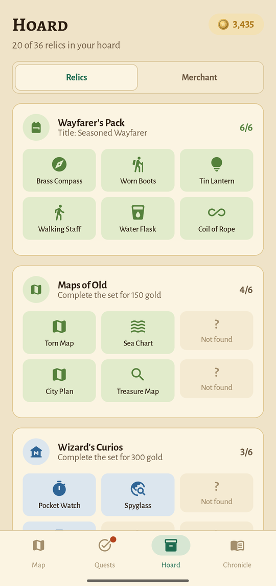
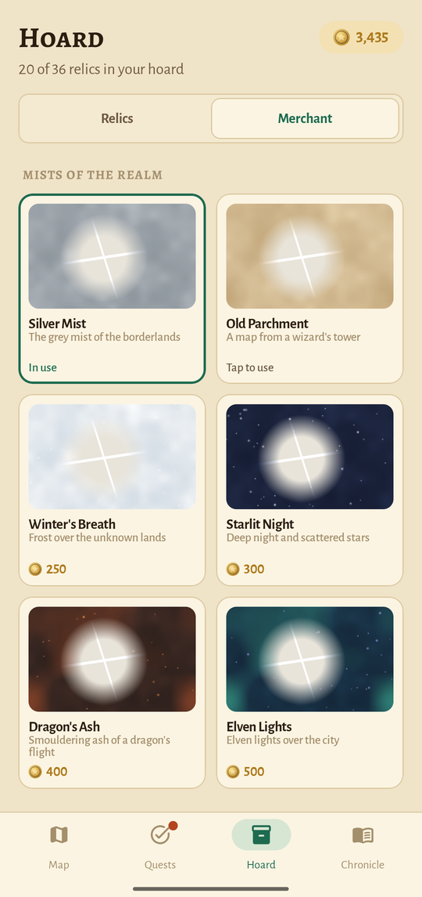
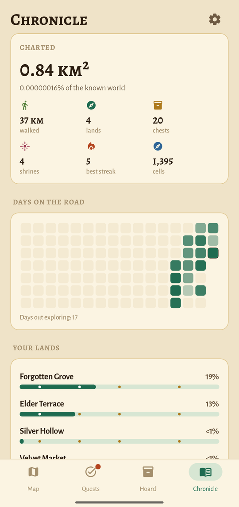
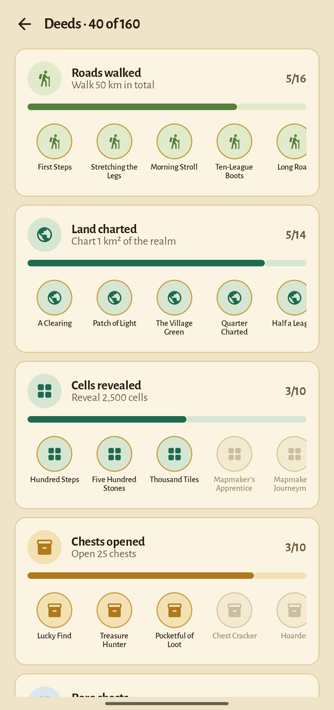

<div align="center">


# Fogwalk

### Your city, hidden in mist. Walk to reveal it.

*A fantasy exploration game for real walks: the map starts grey, and every street you walk is charted for good. Treasure chests, three shrines a day, altars that lift the mist where you cannot walk, 60 relics with stars, seasonal sets, arms of the lands, 209 deeds, quests, oaths, treasure maps and races against your own shadow. Free, no ads, no account.*

[](https://github.com/bigdevwhale/fogwalk/actions/workflows/android.yml)
[](https://github.com/bigdevwhale/fogwalk/releases/latest)


[](LICENSE)

**English** · [Русский](README.ru.md) · [Website](https://bigdevwhale.github.io/stillcraft/apps/fogwalk/) · [Changelog](CHANGELOG.md)



</div>

---

## The idea

Most of us walk the same three routes for years. There are streets two blocks away we have never seen.

Fogwalk turns the city into an old atlas lost in mist. Wherever you walk, the mist parts and stays parted. Week by week your neighbourhood fills in, then the next one, and the grey patches start to itch. On the way there are chests to open, a shrine to reach every day and relics to collect, so there is always a reason to go out again and turn left where you always turn right.

## What's inside

| | Feature | How it works |
|---|---|---|
| 🌫️ | **The mist** | The world is cut into cells about 20–40 m across. Walk, and everything within 40 m of your path is revealed for good, drawn as soft clearings in a cloudy mist over a sepia map. |
| 🧭 | **Lands** | The realm is divided into named lands about a kilometre across, from *Whispering Hollow* to *Mossy Wharf*. Chart 5, 15, 25 and 40 % of a land for rewards. |
| 🧰 | **Treasure chests** | Common, rare, epic and legendary chests are hidden all over the map and **refill every Monday**, even on streets you already know. Nearby ones glimmer through the mist as a "?". Walk within 30 m to open one. |
| ✨ | **Shrines of the day** | Each day three shrines awaken 0.6–1.7 km away, each in its own direction where the mist is thickest: golden (more gold), grove (experience and a lantern, a seeing stone or a ward) and azure (an altar). One of them wakes a day; pick one to set out for, and the others won't take you by chance. |
| 🔷 | **Altars** | Fenced yards and lakes stay grey however much you walk. Set altars from azure shrines around such a place, each within 400 m of the last, close the ring, and the mist inside it lifts. |
| 🏺 | **60 relics** | Six sets all year, from the Wayfarer's Pack to the Gifts of the Heavens: a brass compass, a dragon's scale, a void pearl. A full set earns a title and gold. |
| ❄️ | **Seasonal sets** | Four more sets, one per season: the Midwinter Hoard, Gifts of the Thaw, Midsummer Treasures, Harvest Relics. Their relics turn up only in their own season (turned around south of the equator); what stays hidden waits a year. |
| ⭐ | **Relic stars** | A relic found again is not wasted: the 2nd, 4th, 8th, 16th and 32nd copy raise it to ★1…★5. Every time a whole set reaches a star, it pays again. Commons shine in a couple of months; a legendary at five stars is years of walking. |
| 🛡️ | **Arms of the lands** | Every land bears one of 24 arms, the same for every walker: a tower, a bell, a lantern. Chart a quarter of a land to raise its banner; the first banner of each kind pays. A full roll of arms takes lands far from home. |
| 📜 | **Quests** | Three new quests every dawn, a great quest every week. |
| 🔥 | **Streaks** | Reveal 25 cells, walk 1 km or reach the shrine to keep the flame alive. A ward from the merchant guards a missed day. |
| 🤝 | **Oath of the week** | Vow a goal for the rest of the week (easy, hard or heroic, sized to your own pace) and stake gold on it. Keep it, and the stake comes back with a relic and experience that grow with it. Break it, and the gold is gone. |
| 🗺️ | **Treasure maps** | Buy a map and a circle appears in the mist 1–4 km away. Search it on foot by *warmer, colder*; the treasure holds a rare, epic or legendary relic, one you don't have yet if there is any. |
| 👤 | **Race your shadow** | Pick a past journey and walk it again while your shadow retraces it at the old pace. The map shows its way in violet, the panel says who is ahead. Keep favourite routes at hand; a won race is a route of its own, ready to take the beaten one's place. |
| 🏅 | **209 deeds** | 33 ladders of deeds: walk 1 km… 100 km… 1,000 km… 5,000 km; chart a clearing… a kingdom; open a chest… a thousand; a year-long streak; night and dawn journeys; relic stars, seasons and arms. |
| 🪙 | **Gold and the merchant** | Gold buys mists for the map (Old Parchment, Starlit Night, Dragon's Ash, Elven Lights…), gear that improves in five ever dearer steps (a wider reveal, chests felt and opened from farther, longer charms), treasure maps, a weekly tavern rumour of the finest chest nearby, a torch, a seeing stone, wards and a scroll that moves the shrines. |
| 👣 | **Journeys with the screen off** | Tap *Set out* and Fogwalk keeps charting in a quiet notification, with a call when a chest is close. It ignores anything faster than a bike. |
| 📖 | **Chronicle** | Charted area (and your share of the known world), lands, days on the road, your levels, from *Wanderer* to *Legend of the Realm*, and every journey with its route on the map. |

<table>
  <tr>
    <td></td>
    <td></td>
    <td></td>
  </tr>
  <tr>
    <td></td>
    <td></td>
    <td></td>
    <td></td>
  </tr>
</table>

## English & Русский

Every screen, relic, land name and deed is written natively in both languages; Russian land names agree in gender (*Шепчущая Лощина*, *Мшистый Причал*). Switch in **Chronicle → ⚙ → Language**.

## Download

Get the APK from **[Releases](https://github.com/bigdevwhale/fogwalk/releases/latest)**, or the debug APK attached to any [CI run](https://github.com/bigdevwhale/fogwalk/actions/workflows/android.yml). Fogwalk needs Android 8.0 (API 26) or newer and GPS. It works without Google services.

> [!TIP]
> On Xiaomi (MIUI / HyperOS), Huawei and some other phones, allow **Autostart** and remove battery limits so journeys with the screen off aren't cut short.

## Privacy

No accounts, no servers, no analytics, no ads. Your path never leaves the phone: explored cells, chests and progress live in a local database. The only network traffic is map tiles from OpenStreetMap. **Settings → Backup** exports your whole atlas to a JSON file.

## Under the hood

- **Kotlin + Jetpack Compose**, Material 3 with a parchment palette and the Alegreya typefaces.
- **osmdroid** shows OpenStreetMap tiles, recoloured to sepia (or to night ink in the dark theme). The mist is a custom overlay: painted into a bitmap at a third of the screen size, explored cells cut out as soft circles, scaled up with filtering. Coarser zoom levels draw from per-level counters, so a city of walks stays smooth.
- Cells are Web Mercator tiles at zoom 20 packed into a `Long`; explored cells are kept in an open-addressing `LongSet`.
- Chests aren't stored anywhere: every zoom-16 tile seeds 0–3 of them from its coordinates and the week number.
- Plain `LocationManager` (no Play services) in a foreground service for journeys; positions are filled in every 8 m so a walk leaves a continuous corridor.
- **Room** stores cells, days, journeys, finds and a ledger of rewards; **DataStore** holds the settings.

```
app/src/main/java/app/fogwalk/
├── content/     relics, lands, ranks, deeds, quests, nudges (EN + RU)
├── data/        Room database, settings, JSON backup, demo seed
├── domain/      fog store, chests, relics, shrine, quests, levels, streaks, deeds
├── explore/     explorer, location feed, foreground journey service
├── geo/         the cell grid, LongSet
├── notify/      evening reminder, journey notification, chest calls
└── ui/          map (+ mist overlay), quests, hoard, chronicle, deeds, onboarding, settings
```

Build it with `./gradlew assembleDebug`. In debug builds a long press on the map walks you there, for testing at a desk. `./gradlew installDebug -Pdemo` installs `app.fogwalk.demo` with three weeks of walks through Prague's old town (made from OpenStreetMap by `tools/demo_walks.py`), the one used for these screenshots.

## License

[MIT](LICENSE). Map data © [OpenStreetMap](https://www.openstreetmap.org/copyright) contributors. Part of [Stillcraft](https://bigdevwhale.github.io/stillcraft/), small tools for a quieter mind.
