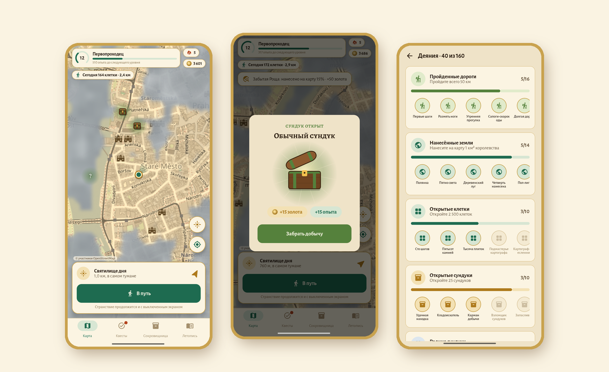
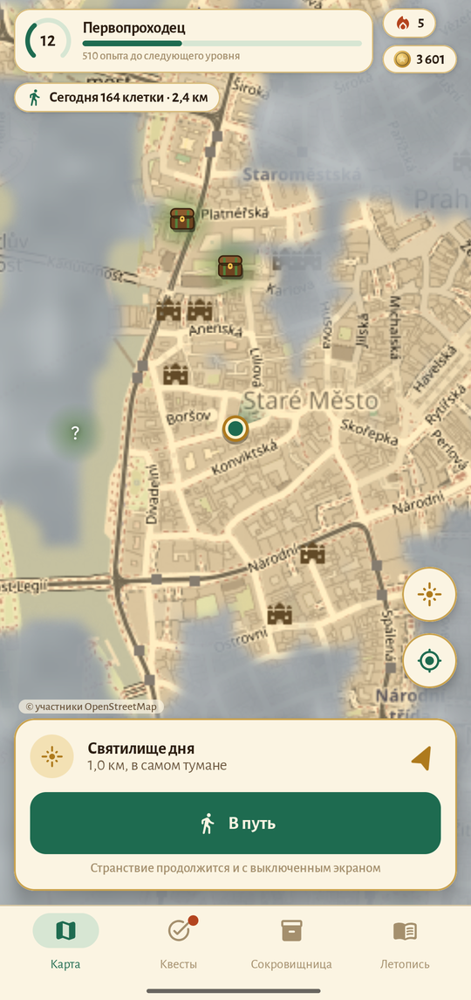
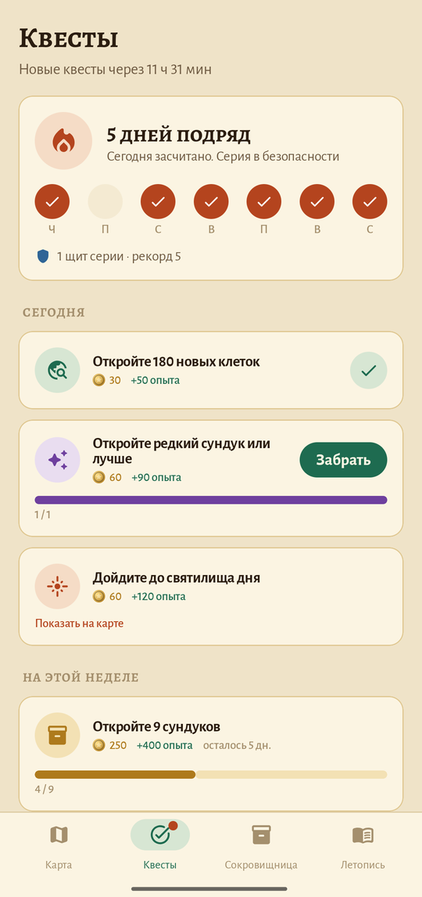
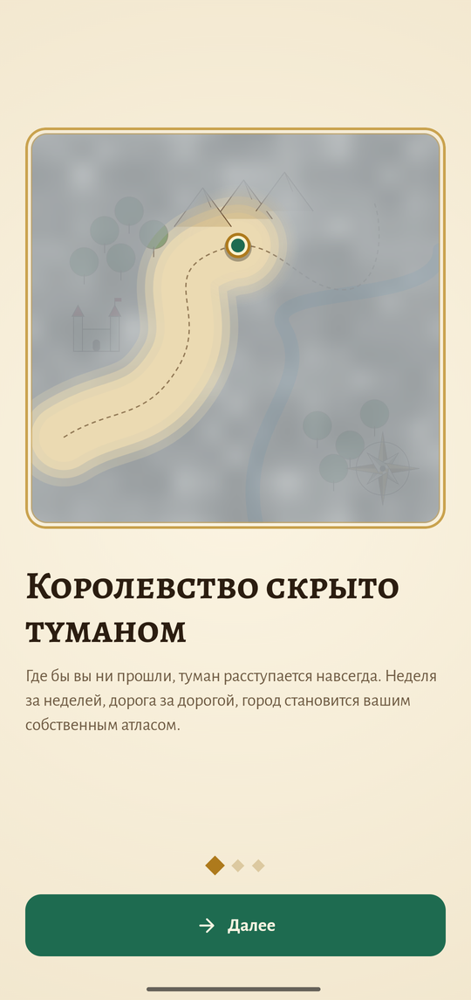
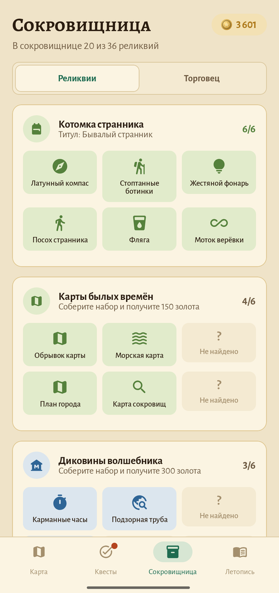
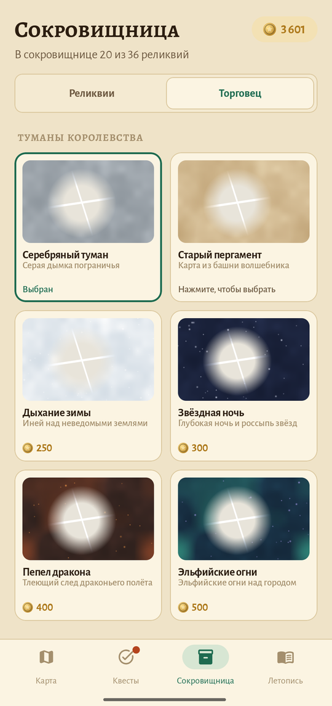
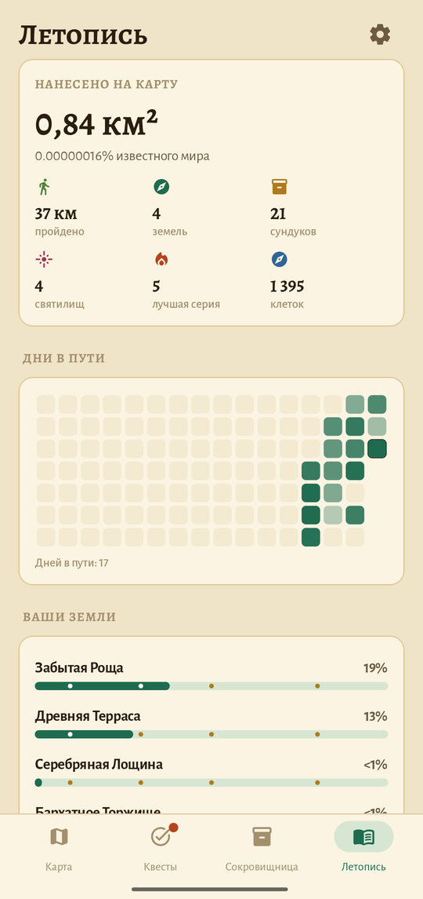
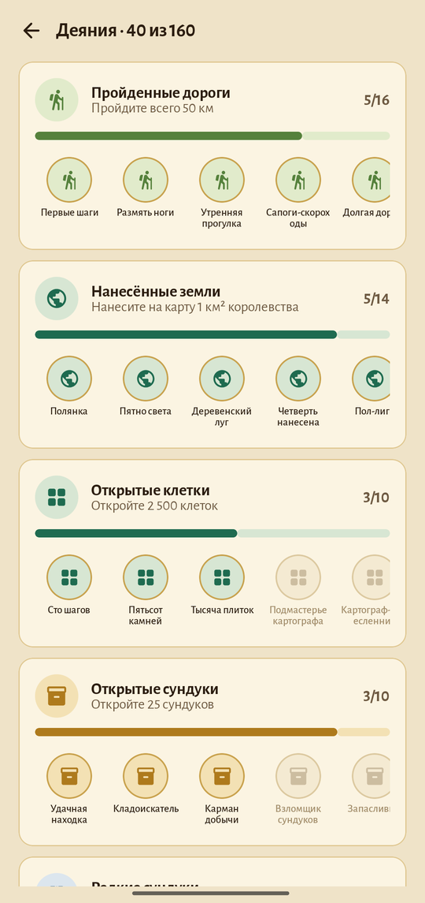

# Fogwalk

### Ваш город скрыт туманом. Пройдите, чтобы открыть его.

*Фэнтези-игра для настоящих прогулок: карта сначала серая, и каждая пройденная улица остаётся на ней навсегда. Сундуки с сокровищами, святилище дня, 36 реликвий, 160 деяний, квесты и серии. Бесплатно, без рекламы и аккаунта.*

[English](README.md) · **Русский** · [Сайт](https://bigdevwhale.github.io/stillcraft/apps/fogwalk/) · [Изменения](CHANGELOG.md)

---

## Идея

Большинство из нас годами ходит одними и теми же тремя маршрутами. А в двух кварталах есть улицы, где мы ни разу не были.

Fogwalk превращает город в старинный атлас, затерянный в тумане. Где бы вы ни прошли, туман расступается и больше не возвращается. Неделя за неделей открывается ваш район, потом соседний, и серые пятна начинают манить. По пути встречаются сундуки, каждый день пробуждается святилище, собираются реликвии, так что всегда есть повод выйти снова и свернуть налево там, где обычно идёте направо.

## Что внутри

| | Возможность | Как это работает |
|---|---|---|
| 🌫️ | **Туман** | Мир поделён на клетки по 20–40 м. Всё в радиусе 40 м от вашего пути открывается навсегда: мягкие просветы в облачном тумане над картой в тонах сепии. |
| 🧭 | **Земли** | Королевство поделено на земли около километра в поперечнике, у каждой своё имя: *Шепчущая Лощина*, *Мшистый Причал*. За 5, 15, 25 и 40 % земли на карте полагаются награды. |
| 🧰 | **Сундуки с сокровищами** | Обычные, редкие, эпические и легендарные сундуки спрятаны по всей карте и **появляются заново каждый понедельник**, даже на знакомых улицах. Ближние мерцают сквозь туман знаком «?». Подойдите на 30 м, чтобы открыть. |
| ✨ | **Святилище дня** | Каждый день в 0,6–1,7 км, там, где туман гуще всего, пробуждается святилище. Стрелка показывает путь, а награда за него — лучшая за день. |
| 🏺 | **36 реликвий** | Шесть наборов, от «Котомки странника» до «Даров небес»: латунный компас, чешуя дракона, жемчужина пустоты. За полный набор — титул и золото. |
| 📜 | **Квесты** | Три новых квеста каждый рассвет и великий квест на неделю. |
| 🔥 | **Серии** | Откройте 25 клеток, пройдите 1 км или дойдите до святилища, чтобы огонь не погас. Оберег от торговца спасает пропущенный день. |
| 🏅 | **160 деяний** | 25 лестниц деяний: пройти 1 км… 100 км… 1000 км… 5000 км; нанести на карту полянку… королевство; открыть сундук… тысячу; серия длиной в год; ночные и рассветные странствия. |
| 🪙 | **Золото и торговец** | За золото — туманы для карты («Старый пергамент», «Звёздная ночь», «Пепел дракона», «Эльфийские огни»…), факел для широкой тропы, камень прозрения, который показывает все сундуки, обереги и свиток, переносящий святилище. |
| 👣 | **Странствие с выключенным экраном** | Нажмите «В путь», и Fogwalk продолжит наносить карту с тихим уведомлением, а когда рядом сундук, позовёт. Всё быстрее велосипеда не считается. |
| 📖 | **Летопись** | Нанесённая площадь (и ваша доля известного мира), земли, дни в пути, уровни от *Странника* до *Легенды королевства* и история странствий с маршрутом каждого на карте. |

<table>
  <tr>
    <td></td>
    <td></td>
    <td></td>
  </tr>
  <tr>
    <td></td>
    <td></td>
    <td></td>
    <td></td>
  </tr>
</table>

## English и Русский

Каждый экран, реликвия, имя земли и деяние написаны на обоих языках, а не переведены машиной; русские имена земель согласованы по роду. Язык меняется в **Летопись → ⚙ → Язык**.

## Скачать

APK — в **[Releases](https://github.com/bigdevwhale/fogwalk/releases/latest)**, отладочный APK — в любом [запуске CI](https://github.com/bigdevwhale/fogwalk/actions/workflows/android.yml). Нужен Android 8.0 (API 26) или новее и GPS. Сервисы Google не требуются.

> [!TIP]
> На Xiaomi (MIUI / HyperOS), Huawei и некоторых других телефонах разрешите **автозапуск** и снимите ограничения батареи, чтобы странствия с выключенным экраном не обрывались.

## Приватность

Ни аккаунтов, ни серверов, ни аналитики, ни рекламы. Ваш путь не покидает телефон: открытые клетки, сундуки и прогресс хранятся в локальной базе. В сеть уходят только запросы тайлов карты OpenStreetMap. **Настройки → Резервная копия** сохраняет весь атлас в JSON-файл.

## Как устроено

- **Kotlin + Jetpack Compose**, Material 3 с пергаментной палитрой и шрифтами Alegreya.
- **osmdroid** показывает тайлы OpenStreetMap, перекрашенные в сепию (или в ночные чернила в тёмной теме). Туман — свой оверлей: рисуется в битмап в треть экрана, открытые клетки вырезаются мягкими кругами, и битмап растягивается с фильтрацией. На мелком масштабе туман рисуется по счётчикам уровней, поэтому даже город прогулок не тормозит.
- Клетки — тайлы Web Mercator на 20-м зуме, упакованные в `Long`; открытые хранятся в `LongSet` с открытой адресацией.
- Сундуки нигде не хранятся: каждый тайл 16-го зума выводит 0–3 сундука из своих координат и номера недели.
- Обычный `LocationManager` (без Play Services) в foreground-сервисе; между точками путь достраивается каждые 8 м, поэтому прогулка оставляет сплошной коридор.
- **Room** хранит клетки, дни, странствия, находки и журнал наград; **DataStore** — настройки.

Сборка: `./gradlew assembleDebug`. В отладочной сборке долгое нажатие на карту «проводит» вас туда — удобно тестировать за столом. `./gradlew installDebug -Pdemo` ставит `app.fogwalk.demo` с тремя неделями прогулок по старой Праге (сделаны из OpenStreetMap скриптом `tools/demo_walks.py`) — именно эта сборка на скриншотах.

## Лицензия

[MIT](LICENSE). Картографические данные © участники [OpenStreetMap](https://www.openstreetmap.org/copyright). Часть [Stillcraft](https://bigdevwhale.github.io/stillcraft/) — маленьких инструментов для спокойного ума.
